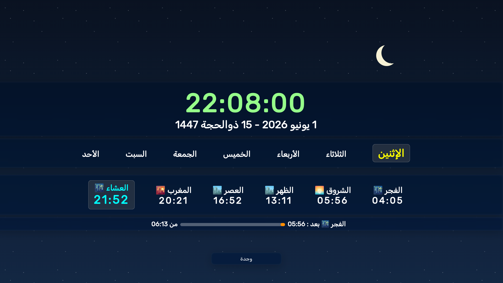

# Pray in' Time

A simple cool designed prayers time app.

## Features

- Currently, it only supports cities from Morocco.
- If you wish to add cities or change the country & add cities for that country :
  - 1- change "country=MA" in api.ts/getPrayerTimes/get-api-url to your country code
  - 2- change CITIES const in data.ts with your country cities 

## Tech

Built using Angular 21, and signals. 

## Preview

